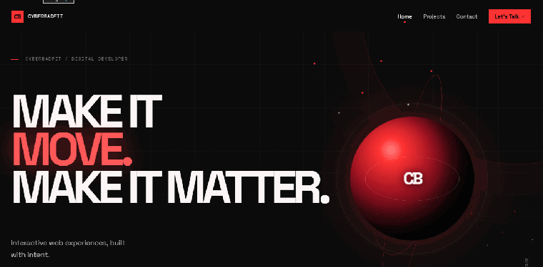
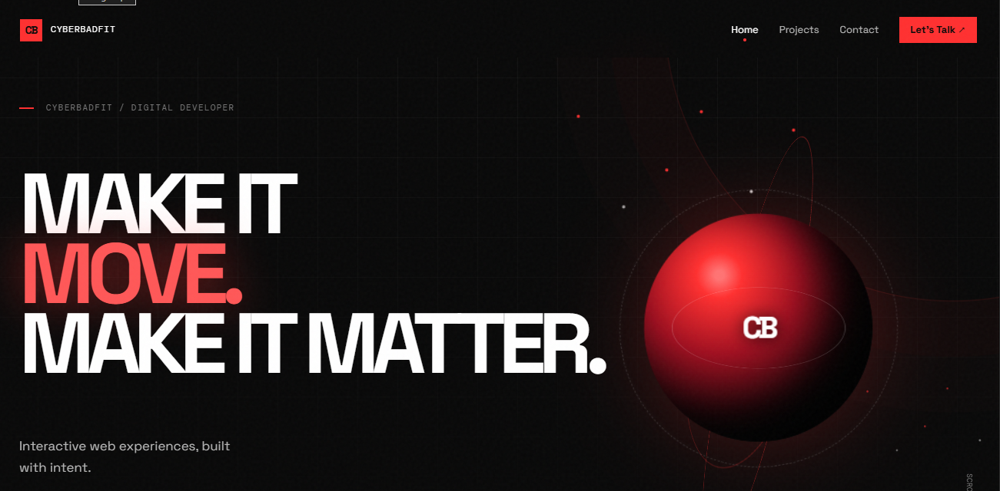
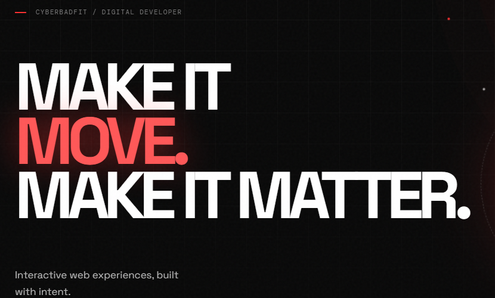
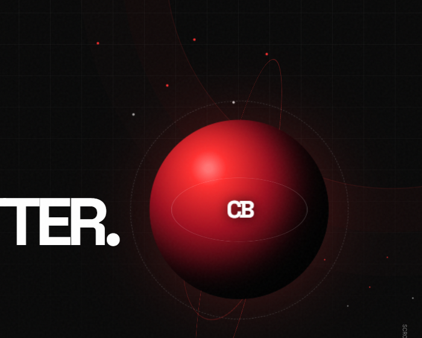

<div align="center">

# CYBERBADFIT — Portfolio Website

### A high-impact developer portfolio built to make work feel intentional.

[](https://react.dev/)
[](https://www.typescriptlang.org/)
[](https://vite.dev/)

**[Explore the source](./src)** · **[Run locally](#getting-started)** · **[Production build](#production-build)**

</div>

---

An editorial, single-page developer portfolio for **CYBERBADFIT**. The experience uses a sharp red, black, and white visual system, expressive typographic scale, and purposeful motion to present public work with clarity and character.

> Built as a static React application: no backend, tracking script, credential, or private token is required.

## Motion preview

<p align="center">
  
</p>

## Interface preview

<p align="center">
  
</p>

<p align="center">
  
  
</p>

<p align="center"><sub>Previews are captured from the project design included in this repository.</sub></p>

## Why this project stands out

- **Editorial visual direction** — high-contrast colour, oversized type, grid texture, and intentional empty space create a distinctive developer-brand experience.
- **Purposeful motion** — a CSS 3D hero orb, animated orbits, scrolling type, hover states, and entry reveals add energy without a WebGL dependency.
- **Responsive by design** — the navigation, hero, project cards, layout, and type scale adapt for mobile through desktop screens.
- **Live public-work signal** — repository and profile metrics load from the public GitHub API, with reliable local project data used as a fallback.
- **Accessible foundations** — semantic landmarks, a skip link, keyboard-dismissible mobile navigation, external-link safety, and `prefers-reduced-motion` support are included.

## Feature set

| Area | Included |
| --- | --- |
| Navigation | Sticky desktop nav, active-section state, animated mobile menu, Escape-to-close support |
| Hero | CSS 3D orb, pointer-responsive tilt, orbit system, visual grid, CTA buttons |
| Projects | Public GitHub data, local fallback data, repository filters, external repository/demo links |
| Motion | Loading state, section reveals, marquee, hover transitions, reduced-motion alternative |
| Quality | TypeScript, responsive CSS, robots.txt, sitemap placeholder, favicon, Open Graph metadata |

## Tech stack

| Layer | Tools |
| --- | --- |
| UI | React 19, TypeScript |
| Build | Vite |
| Styling | Custom CSS, responsive media queries, CSS animations |
| Data | GitHub public REST API with local fallback |
| Hosting | Any static host — GitHub Pages, Vercel, Netlify, or Cloudflare Pages |

## Project structure

```text
portfolio website/
├── assets/previews/       # README gallery and animated motion preview
├── public/                # Favicon, robots.txt, sitemap placeholder
├── src/
│   ├── data/projects.ts   # Local project data when the API is unavailable
│   ├── lib/github.ts      # Public GitHub profile/repository integration
│   ├── App.tsx            # Page composition and interactions
│   ├── main.tsx           # React entry point
│   └── styles.css         # Design system, layout, motion, responsive rules
├── index.html
├── package.json
└── vite.config.ts
```

## Getting started

### Prerequisites

- [Node.js](https://nodejs.org/) 20 or later
- npm 10 or later

### Install and run

```bash
git clone https://github.com/Cyberbadfit/Full-Stack-Web-Development-Projects.git
cd "Full-Stack-Web-Development-Projects/portfolio website"
npm install
npm run dev
```

Vite prints the local address after startup, normally `http://localhost:5173`.

### Available commands

| Command | Purpose |
| --- | --- |
| `npm run dev` | Start the local development server |
| `npm run build` | Type-check and generate the optimized static site in `dist/` |
| `npm run preview` | Preview the production build locally |

## GitHub data behaviour

The site reads only public data for [`Cyberbadfit`](https://github.com/Cyberbadfit): the visible repository list and public profile counters. No token is sent to the browser.

If GitHub is unavailable, the application keeps working by loading the curated project list in [`src/data/projects.ts`](./src/data/projects.ts). Update that file whenever the portfolio's featured work changes.

## Production build

```bash
npm run build
npm run preview
```

The static output is written to `dist/`. Deploy that folder to a static host. For GitHub Pages beneath a repository path, set Vite's `base` option before building.

## Customisation guide

| Want to change | File to edit |
| --- | --- |
| Page copy, sections, and CTA destinations | [`src/App.tsx`](./src/App.tsx) |
| Colours, typography, responsive layout, and animation | [`src/styles.css`](./src/styles.css) |
| Fallback projects and categories | [`src/data/projects.ts`](./src/data/projects.ts) |
| Public GitHub API integration | [`src/lib/github.ts`](./src/lib/github.ts) |
| Metadata and document title | [`index.html`](./index.html) |

## Quality checks

- [x] `npm run build` passes successfully
- [x] Desktop and mobile-responsive layouts included
- [x] Keyboard navigation and reduced-motion support included
- [x] Static-host deployment ready

## Author

Created for **[Cyberbadfit](https://github.com/Cyberbadfit)**.

<div align="center">

<sub>Crafted with intent. Make it move. Make it matter.</sub>

</div>
